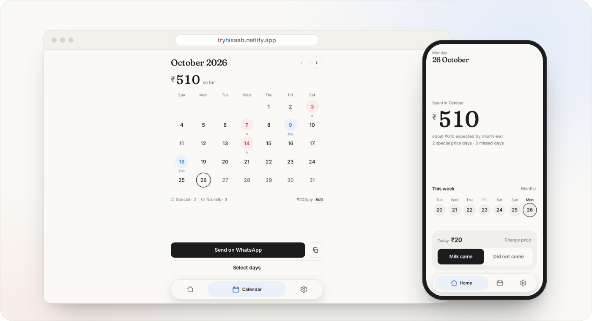

<p align="center">
  
</p>

<h1 align="center">Hisaab</h1>

<p align="center">Your milk bill, sorted.</p>

<p align="center">
  <a href="https://tryhisaab.netlify.app"><b>Open the app</b></a> &nbsp;·&nbsp;
  <a href="#install">Install</a> &nbsp;·&nbsp;
  <a href="#your-data">Your data</a> &nbsp;·&nbsp;
  <a href="docs/development.md">Development</a>
</p>

<p align="center">
  
</p>

---

Hisaab keeps a running total of your daily milk bill. You set the price once. After that you only open the app on the days that were different, when the milk didn't come or cost something else. When you want to settle up, it writes the bill and sends it to your milkman on WhatsApp.

*Hisaab* (हिसाब) means "account" or "reckoning" in Hindi and Urdu. The app works in English, हिंदी and অসমীয়া, runs offline, and has no sign-up. Everything you enter stays on your phone.

## How it works

1. Set the price per day for the month. Next month starts with the same price, so most months need no setup at all.
2. Tap a day when something was different. Mark it as missed, or give it a one-off price. If the milkman raises his rate on the 15th, enter the new price from that day and the bill splits itself in two.
3. Send the bill. One tap opens WhatsApp with the message ready, or you can hand it to any other app through the share sheet.

This is what the milkman gets:

```
Milk bill
October 2026 (1–26 Oct)
──────────
11 days × ₹20 = ₹220
12 days × ₹25 = ₹300 (from 15 Oct)
Special price: 9 Oct ₹60
No milk: 2 days (3, 7 Oct)
──────────
Total: ₹580
```

Every line adds up to the total, so he can check it against his own notebook.

## What's in it

Home shows the total so far this month and a forecast for the end of it. Below that is the current week, with Milk came and Did not come as one tap each.

The calendar shows the whole month. You can edit one day, or select several at once, which helps when you were away for a week. If milk never misses at your house, turn off "Track days milk did not come" in Settings and the missed-day buttons go away.

The bill goes to a number you save once, or to whoever you pick if you leave it empty. The bill's language doesn't have to match the app's, so you can use the app in English and send the bill in Hindi. The bill ends with a short link to the app, which you can switch off in Settings.

Backups are a JSON file you download and can restore on another phone. Home reminds you after 14 days if you've never made one, and every 30 days after your first.

On Android, long-press the installed icon for three shortcuts: No milk today, Milk came today and Open calendar.

## Your data

Hisaab has no backend. Your entries are saved in your browser's local storage, on your phone, and nowhere else. There is no account, no analytics and no tracking. The app's code sends nothing anywhere. Search `js/` for `fetch` and you won't find a call. Even the fonts are bundled instead of loaded from Google.

Two things leave the app, and only when you tap. Send on WhatsApp opens WhatsApp with the bill text. The share button hands the same text to whichever app you choose.

The trade-off: if you clear your browser's site data or uninstall the app, your history goes with it. That is why backups are there.

## Install

Open [tryhisaab.netlify.app](https://tryhisaab.netlify.app) on your phone.

- **Android (Chrome):** open the menu and tap Install app, or Add to Home screen.
- **iPhone (Safari):** tap Share, then Add to Home Screen.

It needs the internet for the first visit only. After that it opens full screen and works offline. The offline copy is about 430 KB, plus the fonts for Hindi or Assamese if you use them.

## Languages

English, हिंदी (Hindi) and অসমীয়া (Assamese). The Hindi and Assamese text is a first draft and needs a native speaker's eye. If something reads wrong, [open an issue](https://github.com/mosaddiqdev/hisaab/issues). Corrections are the most useful contribution right now.

## Development

No framework, no bundler and no runtime dependencies, just ES modules. About 170 KB of JavaScript and CSS before compression.

```
python3 -m http.server 8080
npm test
```

The project structure, the scripts that generate the fonts and images, and the release steps are in [docs/development.md](docs/development.md).

## Credits

Built by [mosaddiqdev](https://github.com/mosaddiqdev). Type is set in Fraunces and Inter, with Hind, Hind Siliguri, Tiro Devanagari Hindi and Tiro Bangla for the Indic scripts, all under the SIL Open Font License. The licences are in [`fonts/licenses`](fonts/licenses).
